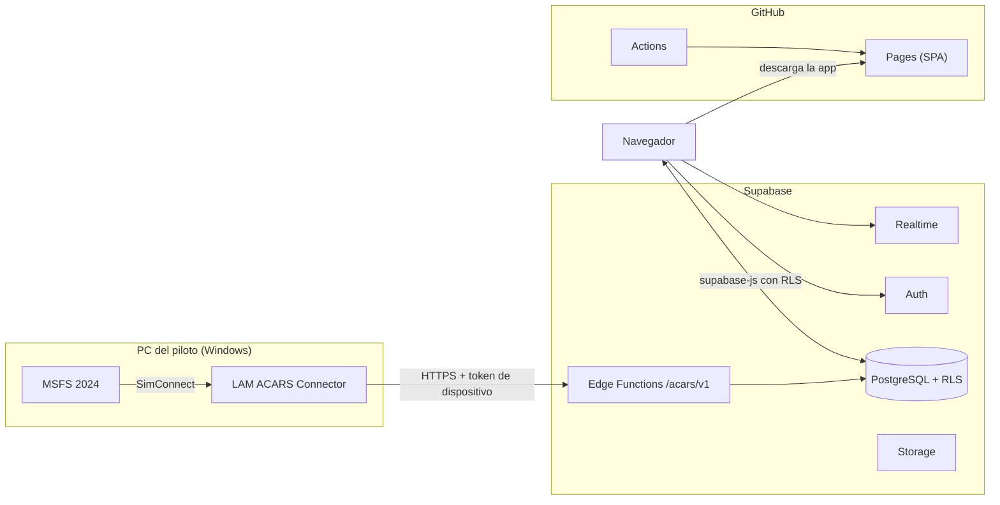

# Arquitectura

LAM Virtual ACARS tiene tres piezas: un sitio estático en GitHub Pages, Supabase como único backend y, a partir de la Fase 4, un conector de Windows para MSFS 2024.

## Principios

1. **Ninguna regla de negocio depende del navegador.** El sitio es público y estático; la autorización vive en RLS, en funciones SQL y en Edge Functions.
2. **El navegador solo tiene la clave publicable.** La clave secreta de Supabase existe únicamente en los secretos de Edge Functions.
3. **El conector escribe solo por Edge Functions**, con un token de dispositivo revocable (Fase 4).
4. **Datos reales o estado vacío.** La interfaz nunca muestra cifras de ejemplo como si fueran operación real.

## Web (`apps/web`)

| Aspecto | Decisión |
| --- | --- |
| Framework | Vite + React 19 + TypeScript estricto |
| Enrutamiento | React Router (modo biblioteca) con `basename` = ruta de Pages |
| Rutas profundas | `index.html` se copia como `404.html` en el build |
| Datos | supabase-js + TanStack Query |
| Formularios | React Hook Form + Zod (`@lam/validation`) |
| Estilos | Tailwind CSS 4 con tokens CSS; modo oscuro y claro |
| Autenticación | Supabase Auth, flujo PKCE |
| Seguridad | Content Security Policy por `<meta>` (Pages no admite cabeceras propias) |

### Rutas de la Fase 1

| Ruta | Acceso | Contenido |
| --- | --- | --- |
| `/bienvenida` | Pública | Presentación y aerolíneas activas |
| `/entrar`, `/registro`, `/recuperar` | Solo sin sesión | Acceso y alta |
| `/auth/callback` | Pública | Destino del enlace de confirmación de correo |
| `/restablecer` | Con enlace de recuperación | Nueva contraseña |
| `/` | Con sesión | Dashboard |
| `/settings` | Con sesión | Perfil, contraseña y sesiones |

## Backend (Supabase)

- Migraciones versionadas en `supabase/migrations`, probadas con pgTAP en CI.
- Funciones de autorización en el esquema `private` (no expuesto por la Data API).
- RPC públicas solo cuando devuelven agregados sin datos personales (`get_dashboard_summary`).
- Auditoría de cambios administrativos por disparadores en `audit_logs`.

## Entornos

| Entorno | Web | Base de datos |
| --- | --- | --- |
| Local | `pnpm dev` | `supabase db start` (Docker) |
| CI | Build con valores de ejemplo | Supabase CLI en el runner |
| Producción | GitHub Pages | Proyecto Supabase `fnsfgjtmwfiizofsjajm` |
