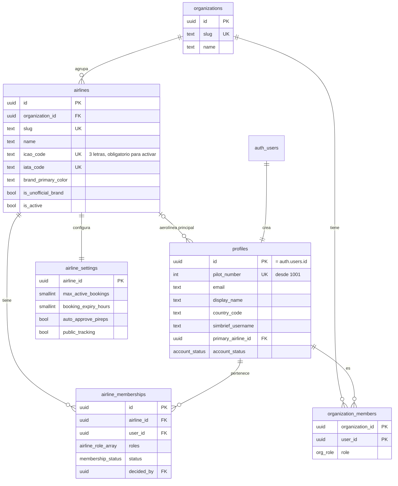

# Modelo de datos

El esquema separa la plantilla (ruta), la operación (vuelo), el estado vivo, los eventos, la traza histórica y el reporte final (PIREP). Toda tabla operacional lleva `airline_id` para aislar datos por aerolínea con RLS.

## Fase 1 (implementado)

`audit_logs` no tiene claves foráneas a propósito: conserva el historial aunque se borre la persona o la aerolínea.

### Reglas que impone la base de datos

| Regla | Mecanismo |
| --- | --- |
| Una aerolínea activa tiene código ICAO | `check airlines_active_requires_icao` |
| Una persona tiene una sola membresía por aerolínea | `unique (airline_id, user_id)` |
| Cada aerolínea tiene configuración | Disparador `airlines_create_settings` |
| El perfil se crea al registrarse | Disparador `on_auth_user_created` sobre `auth.users` |
| El correo del perfil sigue al de Auth | Disparador `on_auth_user_email_changed` |
| Solo un superadministrador cambia códigos, estado u organización de una aerolínea | Disparador `airlines_guard_update` |
| El piloto no cambia su correo, estado ni fecha de alta | Disparador `profiles_guard_update` |
| La aerolínea principal requiere membresía activa | Disparador `profiles_guard_update` |
| Solo un superadministrador nombra o modifica administradores de aerolínea | Disparador `airline_memberships_guard_write` |
| Cambiar el estado de una membresía registra quién y cuándo | Disparador `airline_memberships_guard_write` |
| Al perder la membresía activa se limpia la aerolínea principal | Disparador `airline_memberships_clear_primary` |
| Cambios administrativos auditados | Disparadores `*_audit` |

### Decisión: roles como arreglo en la membresía

Los roles por aerolínea se guardan como `airline_role[]` en `airline_memberships` en lugar de las tablas `roles`, `permissions` y `membership_roles`. Ver [ADR 0003](../decisions/0003-roles-por-membresia.md).

## Fases siguientes (diseño conceptual)

| Grupo | Tablas | Fase |
| --- | --- | --- |
| Flota | `aircraft_types`, `aircraft`, `pilot_type_ratings` | 2 |
| Red | `airports`, `routes`, `route_aircraft_types` | 2 |
| Operación | `flight_bookings`, `flights`, `simbrief_ofps` | 3 |
| ACARS | `acars_devices`, `acars_link_codes`, `flight_sessions`, `flight_positions_live`, `flight_track_points`, `flight_events` | 4 |
| PIREP | `pireps`, `pirep_reviews`, `scoring_rule_sets`, `flight_scores` | 5 |
| Estadísticas | `pilot_statistics` y vistas de agregados | 5 y 6 |

Cada fase diseña en detalle sus tablas al empezar, para no fijar decisiones antes de tiempo.

### Telemetría (Fase 4)

| Dato | Frecuencia hacia la nube | Tabla | Retención |
| --- | --- | --- | --- |
| Posición viva | Cada 10 s | `flight_positions_live` (una fila por vuelo, sobrescrita) | Se borra al terminar |
| Traza | Lotes cada 60 s, puntos reducidos por fase | `flight_track_points` (particionada por mes) | 90 días |
| Eventos | Inmediato, con idempotencia | `flight_events` | Permanente |
